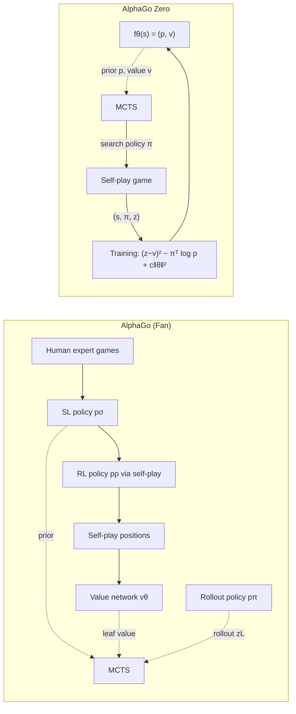

# Critical Assessment of the Draft "Learning and Search in AlphaGo and AlphaGo Zero"

| Item | Detail |
|---|---|
| Course / task | DLMAIRIL01 Reinforcement Learning, Written Assignment, Task 1 (AlphaGo) |
| Level / length | Master, 12–15 pages of text (Introduction to Conclusion, tables and figures included) |
| Assessed version | `AlphaGo_Task1_Research_Draft.docx` / `.pdf`: 17 pp. in total, main text pp. 1–13, ≈ 4,570 words, 6 references, 1 table, 7 equations, 0 figures |
| Benchmarks applied | Task sheet DLMAIRIL01; *Guidelines Written Assignment* (criteria and weights); *Guidelines for Structuring and Formatting Academic Papers* (01/10/2025); *Allgemeiner Zitierleitfaden* (01/10/2026); IU Citation Guideline (library slides); *Guideline for Avoiding Plagiarism* |
| Verification | Facts from Silver et al. (2017) were checked against the UCL accepted manuscript cited in the draft (page numbers below refer to that manuscript). Facts from Silver et al. (2016) were checked against the paper's text, but page numbers marked *verify* still need checking against the printed article. |
| Paragraph references | "¶n" means the n-th prose paragraph of a subsection in the draft. Short lines that introduce an equation (e.g. "An explanatory expression … is:") count as paragraphs; equations, tables and table notes do not. |

---

## 0 Verdict at a glance

The draft is technically literate and mostly correct. Its problem is that it explains instead of arguing. It often says what the evidence *does not* prove, but it leaves out the results that show what the evidence *does* prove: Elo ratings, ablation results, win rates and hardware figures. The literature base is below Master level. It has six titles, 28 of the 34 in-text citations (82 %) point to two DeepMind papers by the system's own authors, and there is no source published after 2017. This makes the "critical evaluation" self-referential. Most marks are lost in **Reasoning (40 %)**, and the paper loses further marks for a thin **Conclusion (15 %)**.

**Indicative marking of the current draft by a strict marker.** This is not an official IU grade.

| Criterion | Weight | Indicative score | Weighted |
|---|---:|---:|---:|
| Introduction | 10 % | 60 % | 6.0 |
| Structure | 15 % | 65 % | 9.8 |
| Reasoning | 40 % | 60 % | 24.0 |
| Conclusion | 15 % | 50 % | 7.5 |
| Language / form | 10 % | 70 % | 7.0 |
| Formalities | 10 % | 75 % | 7.5 |
| **Total** | | | **≈ 62 %** |

**Five changes that gain the most per hour of work.** Each task ID refers to Section 6.

1. Add the quantitative evidence (Elo ladder, ablations, win rates, compute) and rebuild Chapter 5 around it (T04, T05, T06).
2. Resolve the contradiction in the central thesis, using the two quasi-controlled comparisons that Silver et al. (2017) already report: supervised learning versus self-play with an identical architecture, and AlphaGo Master versus AlphaGo Zero (T05).
3. Expand the literature from 6 to 15–20 sources, including a textbook, the origins of MCTS, an independent replication, critiques and post-2017 work (T08, T09).
4. Rewrite the Introduction and the Conclusion so that each takes about 10 % of the text, with a research gap, a method description, limitations and further research (T01–T03, T10).
5. Fix the formal problems: the IU table format, the abbreviation list, the title page and citations at paragraph level (T07, T20–T24).

---

## 1 Criteria check

### 1.1 IU evaluation criteria versus the draft

| Criterion (weight) | IU requirement (source) | What the draft actually does | Verdict | Gaps and drift | Tasks |
|---|---|---|---|---|---|
| **Introduction (10 %)** | Rationale based on the current state of research and the open questions; scope and definitions; aim or research question; outline; "description and justification of the approach and process" (*Guidelines Written Assignment*, pp. 1, 3) | States an explicit research question and a central argument. Defines the scope (AlphaGo Fan/Lee/Zero; later systems excluded) and labels the method a "focused literature review". | **Partially met** | (a) The rationale is generic ("useful setting"). It gives no state of research, no complexity figures and no account of computer Go before AlphaGo. (b) It ignores the premise of the prompt ("exceeded human-level performance, surprising even experts"). (c) It names no research gap or open question. (d) It does not describe the literature search: databases, search terms, inclusion criteria and source types are missing. (e) The outline is squeezed into one sentence. (f) Bibliographic housekeeping about UCL pagination sits in the body text and belongs in a footnote. (g) At 343 words (≈ 7.5 %), the Introduction is below the ≈ 10 % guideline. | T01–T03 |
| **Structure (15 %)** | Linear, coherent structure with clear transitions; ≈ 10/80/10 split; every section at least half a page; appropriate section lengths (*Guidelines Written Assignment*, p. 1; *Formatting Guidelines*, p. 4) | The macro-order is logical: foundations → AlphaGo → AlphaGo Zero → comparison → conclusion. | **Partially met** | (a) The foundations take more space than the comparison. Section 2.2 (472 words) is the longest subsection, while 5.1, the explicit comparison the task asks for, has 183 words. (b) The same methodological point ("component accuracy ≠ agent strength") appears at least five times (Section 3.3 below). (c) Section 3.2 makes a claim that is only supported in 3.4. (d) Sections end with summaries, not bridges to the next section. (e) The Conclusion has 244 words (≈ 5 %). (f) There is no figure of the MCTS cycle or of the training loops, even though they are the core mechanism. | T12–T15 |
| **Reasoning (40 %)** | "All assumptions, considerations, and arguments must be proven, discussed and confirmed by providing adequate reference sources"; critical weighing of pros and cons (*Guidelines Written Assignment*, p. 2) | Draws careful conceptual distinctions (policy versus value, backup versus backpropagation, loss versus source of supervision) and makes hedged claims. | **Main deficit** | (a) 38 of 67 body paragraphs (57 %) contain no citation. (b) 82 % of citations go to the authors' own reports, and there is no independent replication, critique or post-2017 source. (c) Quantitative evidence is withheld: no Elo values, no ablation outcomes, no hardware figures. (d) The central thesis is asserted, and the paper's own cited evidence contradicts it (W1). (e) "Critical evaluation" consists mainly of negated caveats ("does not establish…"), not of weighing competing sources. | T04–T09, T16–T19 |
| **Conclusion (15 %)** | Conclusion and recommendations, limitations, further research areas (*Guidelines Written Assignment*, p. 3) | Answers the research question, with one sentence on limitations, one on future research and one on practice. | **Weak** | (a) It is too short (≈ 5 %). (b) The limitations of the review method (reliance on self-reported results, no experiments, the pagination of the manuscript) are only hinted at. (c) The proposed "next investigation" has partly been carried out already in the main source (Silver et al., 2017, p. 8, Figure 3; pp. 12, 22 on AlphaGo Master). (d) There are no concrete recommendations. | T10 |
| **Language / form (10 %)** | Precise, scientific wording | Grammar is clean and British spelling is consistent. | **Adequate** | (a) A defensive negation style: 34 sentences state what something is *not*. (b) Vague quantifiers where exact values exist. (c) "Therefore" appears 16 times. (d) Meta-sentences without content ("This perspective matters…"). (e) The uniform, hedged prose looks machine-generated (see 4.1, integrity risk). | T18, T11 |
| **Formalities (10 %)** | IU formatting and citation guidelines | Margins of 2 cm, Arial 11, 1.5 line spacing, justified text, 6 pt after paragraphs, heading sizes 16/14 pt, Roman/Arabic page numbering, a 1.27 cm hanging indent in the reference list and a length of 13 pp. (within 12–15) all comply. | **Mostly met** | (a) The table uses APA style ("Table 1 / *Note.*") instead of the IU style ("Tab. 1 … / Source: Own representation based on …"). (b) "AI" and "SL" are listed as abbreviations but never used, and "RL" appears once. (c) The title page has placeholders, extra content and the wrong order. (d) The Silver et al. (2017) reference is incomplete. (e) The rule that every paragraph needs its own citation is broken. (f) A literal `z_L` appears in the text, and "zₜ" breaks across lines in the PDF. (g) "self play" and "self-play" are mixed. | T20–T26 |

### 1.2 Task-prompt requirements versus the draft

| Element of the prompt | Where | Fulfilment | Gap |
|---|---|---|---|
| Premise: AlphaGo "reached and exceeded human-level performance… surprising even experts" | Intro, 5.2 | ✗ | Only the 5–0 against Fan Hui is reported. That shows **professional** level, not "exceeding human level". The paper never mentions AlphaGo Lee's 4–1 against Lee Sedol (March 2016; Silver et al., 2017, p. 21), AlphaGo Master's 60–0 against top professionals (p. 22), or the pre-2016 baseline of MCTS programs at amateur level (Gelly et al., 2012). The "surprise" is never substantiated. |
| "Describe how AlphaGo works" | 3.1–3.4 | ✓ (largely) | The pipeline is not visualised. The input features are described vaguely ("engineered features"). The value network should be stated precisely as an approximation of the value function of the RL policy (v^{pρ}; Silver et al., 2016, p. 486). |
| "Which deep neural networks are used for which task" | 3.1, Table 1 | ◐ | There is no consolidated inventory listing, for each network, its input, architecture, training data, objective and role in search. Because this is a literal requirement of the prompt, it must be easy to find. |
| "How deep learning approaches were combined with MCTS **to achieve the performance**" | 3.4 | ◐ | The mechanism is explained, but the performance link is not evidenced. Missing results: the mixed evaluation with λ = 0.5 was best (≥ 95 % wins against the other variants), the value network alone beat every other Go program, single-machine AlphaGo won 494 of 495 games, and the distributed version beat the single machine in 77 % of games (Silver et al., 2016, pp. 487–488, *verify*). |
| "Compare the differences between AlphaGo and AlphaGo Zero" | 4, 5.1–5.2, Table 1 | ◐ | Table 1 compares Fan with Zero, but the empirical results the draft cites concern Lee and Master. There is no quantitative comparison (Elo, hardware, training time, data). AlphaGo Lee, the 100–0 benchmark, is never described, although its value network was already trained on outcomes of AlphaGo's own search-based self-play (Silver et al., 2017, p. 21). |
| "The course book is the starting point… research and cite sources" | Intro | ◐ | Not citing the course book is correct, because IU forbids citing scripts (*Zitierleitfaden*, p. 2). However, its bibliography is not used either: Sutton and Barto (2018), Coulom (2006/2007), Sutton (1990), Auer et al. (2002) and Tromp and Farnebäck (2007) are all missing. |

### 1.3 Drift: content that does not serve the task

- **Implementation minutiae in the foundations (≈ 250 words):** the Black/White sign-convention example, backpropagation versus tree backup, and state versus observation. Two sentences each are enough.
- **The "computer vision" analogy appears twice (≈ 180 words):** in 3.1, paragraph 2, and 4.1, last paragraph. Nobody claims a Go board is a photograph, so this rebuts a straw man.
- **Industrial transfer (5.3):** the task does not ask for it. Keep it only if the Introduction announces it as an applied-AI implication and if it is supported by sources. At present it has none.
- **Meta-epistemic caveats:** roughly 11 % of sentences are negations. They show caution, but they use space that the task needs for evidence.

### 1.4 Formal compliance audit

| Requirement | Source | Status | Finding |
|---|---|---|---|
| A4, 2 cm margins, Arial 11, 1.5 spacing, justified text, hyphenation | Formatting guidelines, p. 2 | ✓ | Verified in the DOCX (margins 1134 twips, Normal style Arial 11, line spacing 360, auto-hyphenation on). |
| Headings 16/14/11 pt, bold, left-aligned, 12/12 and 12/6 pt spacing | p. 2 | ✓ | — |
| Page numbering (Roman before the main text, none on page I, Arabic from 1, centred) | p. 3 | ✓ | — |
| Reference list with a 1.27 cm hanging indent, left-aligned, 1.5 spacing | p. 2; Zitierleitfaden, p. 26 | ✓ | — |
| Length 12–15 pp. | Written Assignment Guidelines, p. 3 | ✓ | 13 pp. After rework, stay at 15 pp. or less (Section 7 has a page budget). |
| Table heading "Tab. 1 Title" with "Source: …" below in 10 pt | Zitierleitfaden §2.2.5, pp. 20–24; formatting guidelines, p. 2 example | ✗ | The draft uses APA "Table 1" + italic title + "*Note.* Author synthesis…". IU explicitly deviates from APA here (Zitierleitfaden, p. 20, fn. 4). |
| Abbreviations: only those used, alphabetical, none "for convenience" | Formatting guidelines, p. 5 | ✗ | "AI" and "SL" are listed but never used. "RL" is used once, in Table 1. |
| Title page content and order | Formatting guidelines, pp. 3–4, Appendix B | ✗ | Placeholders remain. "Task 1 AlphaGo" is extra content. "Student number" should read "Matriculation number" and "Tutor" should read "Supervisor/Tutor: [title + name]". The "Degree programme:" label is missing. The order deviates from the template (type of assessment → course → institution → degree programme → title → name → matriculation number → tutor → date). |
| List of tables | Formatting guidelines, p. 5 | ◐ | Only required with three or more tables. One table makes the list superfluous. Remove it, or keep it consistently if you add tables. |
| Citation in every new paragraph that draws on a source | Zitierleitfaden §2.2.3, p. 12 | ✗ | 38 of 67 paragraphs carry no citation (Section 5.2). |
| Page locator for every paraphrase (stricter than APA) | Zitierleitfaden, p. 3, fn. 1 | ◐ | Mostly present. Missing for Williams (1992) and for equations (1), (3) and (4). |
| Stable locator for unpaginated parts | Zitierleitfaden, p. 5 | ◐ | "Methods, 'Problem setting'" is acceptable, but the format should be harmonised, for example *(Silver et al., 2016, Methods section "Problem setting")*. |
| Typography of formulae | — | ✗ | `z_L` appears as literal text (3.4). In the PDF, "zₜ" uses a Unicode subscript character that breaks the line (3.2). Use the equation editor or true subscripts. |
| Consistent terminology | — | ✗ | "self play" (heading 5.3 and the table of contents) versus "self-play" (21 occurrences). |

---

## 2 Logical weaknesses: the three weakest points

### W1: The central thesis is asserted, and the draft's own evidence contradicts it

**Where:** 5.1, paragraph 1; 5.2, paragraph 2; Conclusion, paragraph 3.

**What the draft says:** In 5.1, "The most consequential difference is where the policy-training targets originate." In 5.2, the draft states that match results "do not isolate the causal contribution of each change". The Conclusion then proposes as future work a study that "control[s] architecture, search budget, and training computation while varying the source of policy targets".

**Why it breaks down:**
1. **Internal contradiction.** The paper ranks one factor as "most consequential" while stating, one section later, that the evidence cannot isolate causal contributions. A marker will read this as an unsupported thesis.
2. **The draft cites, but does not report, evidence that cuts the other way.** On a fixed dataset, the architectural change alone added *over 600 Elo* for the residual tower and *around another 600 Elo* for merging policy and value into one network (Silver et al., 2017, p. 8). That is about 1,200 Elo from architecture, with the source of the targets held constant. The thesis must engage with this.
3. **The draft ignores the closest available controlled evidence:**
   - *Same architecture, different target source.* A network with the AlphaGo Zero architecture trained by supervised learning on human games predicted human moves better. Yet the self-play player "defeated the human-trained player within the first 24 hours of training" (Silver et al., 2017, p. 8).
   - *AlphaGo Master as a quasi-control.* Master used "the same neural network architecture, reinforcement learning algorithm, and MCTS algorithm" as AlphaGo Zero. It differed only in using handcrafted features, rollouts and supervised initialisation from human data (p. 22). AlphaGo Zero with 40 blocks beat it 89–11, at 5,185 versus 4,858 Elo (p. 12).
   - *AlphaGo Lee as an intermediate step.* Lee's value network was already "trained from the outcomes of fast games of self-play by AlphaGo… an initial step towards the tabula rasa algorithm" (p. 21). The step from Fan to Zero is therefore a **progression**, not a binary switch, and the draft's two-system framing hides this.
4. **The future-research recommendation is therefore partly redundant.** Proposing as new an experiment that the main source has partly reported will cost marks under both Reasoning and Conclusion.

**Fix:** Reframe the thesis so that it is weighted by the evidence. For example: *"The available ablations attribute substantial gains both to the architectural change (≈ +1,200 Elo on fixed data) and to search-generated targets (the SL versus self-play control; Master versus Zero). The evidence therefore supports a joint rather than a single-factor explanation, with the source of targets being the conceptually decisive change and the architecture the quantitatively demonstrable one."* Then build Section 5.2 around a table with one row per version (Fan → Lee → Master → Zero) and one column per changed factor (T04, T05).

### W2: "To achieve the performance": mechanisms without effect sizes

**Where:** 2.2, paragraph 3; 3.2, paragraph 3; 3.4; 5.2, paragraph 3.

**What the draft says:**
- 2.2: "evaluating a network alone and evaluating the full search agent are different tests."
- 3.2: "this change of objective permits improvement beyond imitation."
- 5.2: "The original paper compares rollout-only, value-only, and combined evaluation."

**Why it breaks down:** All three are empirical claims, and none is supported by its result.
- The *strongest* single piece of evidence for the draft's own learning-plus-planning thesis is missing. AlphaGo Zero's raw network without lookahead reached **3,055 Elo**, whereas the full agent with search reached **5,185 Elo** (Silver et al., 2017, p. 12). Search therefore adds more than 2,000 Elo on top of the same network.
- The claim of "improvement beyond imitation" has no evidence behind it. Without search, the RL policy won more than 80 % of games against the SL policy and 85 % against Pachi (Silver et al., 2016, p. 485).
- The ablation is cited but its outcome is withheld. With λ = 0.5, the mixed evaluation performed best and won at least 95 % of games against the other variants. The value network alone already exceeded every other Go program, so the two evaluators are complementary (Silver et al., 2016, pp. 487–488, *verify*).
- The task explicitly asks how the combination achieved the performance. A purely conceptual account answers "how it works" but not "how it achieved".

**Fix:** For every mechanism, give one result and one locator. Add a short paragraph on component contribution at the end of Chapter 3 and in Section 5.2 (T06).

### W3: The "critical evaluation" is self-referential and largely unsupported

**Where:** 5.1, paragraph 2 ("human knowledge"); 5.2, paragraph 4 ("hardware"); all of 5.3.

**What the draft says:** It criticises the claim "without human knowledge" using only the paper that makes the claim. It discusses compute without giving any numbers. It discusses industrial transfer and "general intelligence" without citing a single source.

**Why it breaks down:**
1. **Human knowledge.** The list of embedded domain knowledge in the draft is incomplete. Silver et al. (2017, pp. 22–23) themselves list:
   - Tromp–Taylor scoring;
   - the set of legal moves;
   - invariance to rotation and reflection, used for data augmentation *and* for random transformations during MCTS;
   - colour transposition;
   - MCTS hyperparameters tuned by Gaussian-process optimisation in a preliminary run.

   An external critique such as Marcus (2018) is needed to make this a *weighing* of positions rather than a paraphrase. AlphaZero later dropped the symmetry augmentation and the evaluator gating (Silver et al., 2018). That shows which "human" design choices were dispensable, which is a genuine argument.
2. **Hardware.** The paragraph argues abstractly although the data exist:
   - for playing, Fan used 176 GPUs, Lee 48 TPUs, and Master and Zero a single machine with 4 TPUs (Silver et al., 2017, pp. 12, 21);
   - for training, Zero used 64 GPU workers and 19 CPU parameter servers (p. 23).

   These figures *prove* the draft's point that playing and training cost must not be conflated. Without them, the paragraph is opinion.
3. **Transfer and robustness (5.3).** It contains no source at all. It also overlooks evidence that directly qualifies it:
   - MuZero plans with a *learned* model and so removes the requirement of an exact simulator that the draft treats as decisive (Schrittwieser et al., 2020).
   - Adversarial policies beat superhuman Go engines in the AlphaZero lineage more than 97 % of the time, by inducing blunders that human experts can replicate (Wang et al., 2023). This is concrete evidence that self-play strength does not imply robustness, and it is far stronger than the unsupported sentence on "general intelligence".
   - The general challenges of applying RL in the real world are documented by Dulac-Arnold et al. (2021).
4. **Reproducibility.** The Introduction notes that results are "not independently reproduced", but an independent reimplementation exists: ELF OpenGo, 20–0 against top professionals (Tian et al., 2019). Using it turns a caveat into evidence.

**Fix:** Rebuild 5.3 as "Limits: human knowledge – compute – robustness – reproducibility – transfer", with at least one non-DeepMind source for each point (T09).

### Further accuracy and precision issues a marker will notice

| Location | Issue | Correction |
|---|---|---|
| Intro, paragraph 1 | MCTS is attributed to Kocsis and Szepesvári (2006). UCT is one bandit-based variant of MCTS. The term and the framework go back to Coulom (2007), and the standard survey is Browne et al. (2012). The course book cites Coulom as well. | Cite Coulom (2007) and Browne et al. (2012) for MCTS in general, and Kocsis and Szepesvári for UCT. |
| 4.3, paragraph 3 | "should not be presented as an identical transcription of every earlier AlphaGo search implementation". This misleads: AlphaGo Fan already used a PUCT variant with the same structure, P·√(ΣN)/(1+N) (Silver et al., 2016, Methods section "Search algorithm", *verify*). The selection rule is *continuous* between the systems, which strengthens the thesis that the change lies elsewhere. | State the continuity and cite Rosin (2011) as the origin of PUCT. Both DeepMind papers cite it. |
| 2.1 | The property "perfect information" is missing, yet it is what makes exact simulation and self-play possible. | Add it. Silver et al. (2017, p. 20) frame Go as a zero-sum alternating Markov game with perfect information (see also Littman, 1994). |
| 3.3 | "expected game outcome under the behaviour represented in its training data" is vague. | "approximates v^{pρ}(s), the value of positions under the RL policy playing both sides (Silver et al., 2016, p. 486)". |
| 4.2, paragraph 3 | It paraphrases Silver et al. (2017, p. 3) ("MCTS may therefore be viewed as a powerful policy improvement operator… policy evaluation operator") **without citation**. Under the IU plagiarism guideline, an uncited paraphrase is plagiarism. | Cite p. 3 and, for the approximate policy-iteration reading, p. 19. Add Grill et al. (2020) for the formal grounding and Danihelka et al. (2022) for the limitation that visit-count targets can fail to improve the policy when few simulations are used. |
| 4.1, paragraph 5 | "smaller and larger configurations" | 20 versus 40 residual blocks (19/39 plus the initial convolutional block), trained for 3 versus 40 days (Silver et al., 2017, pp. 6, 10, 27). |
| 4.3, paragraphs 5 and 7 | "sufficient measured advantage", "samples more broadly during the opening", "root noise" | Gating: win rate above 55 % over 400 evaluation games. Temperature: τ = 1 for the first 30 moves. Noise: Dirichlet(0.03) with ε = 0.25. Search: 1,600 simulations per move (Silver et al., 2017, p. 24). |
| 3.1 | The "tree policy" used during expansion in AlphaGo Fan is not mentioned (minor). | Mention it in one clause, or explicitly exclude it. |

---

## 3 Structure and flow

### 3.1 Macro-structure diagnosis (word counts of the body text)

| Section | Words | Share | Comment |
|---|---:|---:|---|
| 1 Introduction | 343 | 7.5 % | Below the ≈ 10 % guideline. |
| 2.1 + 2.2 Foundations | 716 | 15.7 % | Too heavy. Section 2.2 alone is longer than the explicit comparison in 5.1. |
| 3 AlphaGo | 1,246 | 27.3 % | Adequate, but no evidence of performance. |
| 4 AlphaGo Zero | 1,183 | 25.9 % | Adequate, but carries redundancy (4.1 and 4.3 end on repetitions). |
| 5 Comparison and evaluation | 835 | 18.3 % | **Too light** for the second half of the task and for the 40 % Reasoning criterion. |
| 6 Conclusion | 244 | 5.3 % | **Far below** ≈ 10 %, and the criterion carries 15 %. |

### 3.2 Transition problems

| Location | Problem | Fix |
|---|---|---|
| Intro → 2.1 | The Introduction closes on a compressed outline. Section 2.1 then starts with rules and does not say *why* the formalisation is needed. | Open Chapter 2 with 2–3 sentences of signposting. These are allowed between a chapter and its first subsection (formatting guidelines, p. 4). |
| 2.2 (end) → 3.1 | Section 2.2 ends on "A compact neural input… should not automatically be assumed to establish a complete Markov state", a detail about AlphaGo *Zero's* input, cited to the 2017 paper, placed just before the chapter on AlphaGo Fan. | Move the state/observation point to 4.1, where the 17-plane input is described. End 2.2 with a bridge such as *"AlphaGo instantiates this division of labour with three learned networks and one handcrafted rollout policy."* |
| 3.2, paragraph 3 → 3.4 | It claims that a sharp RL policy may be a poor search prior, but the evidence (the SL prior worked better in search) only arrives in 3.4. The reader meets the claim before the support. | Move the evidence up to 3.2, or flag the forward reference explicitly ("as Section 3.4 shows, …"). |
| 3.3 → 3.4 | 3.3 ends on a general remark about error independence. 3.4 starts abruptly with the search prior. | Bridge to 3.4: *"Because neither evaluator is error-free, AlphaGo combines them at the leaves of the search tree."* |
| 4.1 (last paragraph) | It repeats the computer-vision argument from 3.1. | Delete it and keep one sourced sentence in 3.1. |
| 4.3 (last paragraph) | It repeats the temperature and noise paragraph two paragraphs earlier. | Merge the two into one paragraph and give the numbers. |
| 5.2 (last two paragraphs) | They repeat 3.2, paragraph 5 (prediction accuracy ≠ playing strength). | Keep this argument once, in 5.2, together with the Fig. 3/Fig. 4 evidence from 2017. |
| 5.2 → 5.3 | Industrial transfer appears for the first time in 5.3. The Introduction does not announce it, so it reads as a new topic. | Announce it in the scope part of the Introduction, or cut it to one paragraph within the critique of limitations. |
| End of every subsection | Most subsections end with a summary of a general maxim ("Component quality must therefore be assessed…", "Confusing these operations obscures…"). | Replace these with sentences that lead into the next point (Guidelines Written Assignment, p. 2: "Draw conclusion from the argument (leading to the next point)"). |

### 3.3 Redundancy map: one idea, many places

| Idea | Occurrences | Keep |
|---|---|---|
| "Network-alone evaluation ≠ full-agent evaluation; component quality must be judged by its role" | 2.2 ¶3; 3.2 ¶3; 3.2 ¶5; 3.4 ¶6; 5.2 ¶5–6; 6 ¶1 | Once in 2.2 as the principle, once in 5.2 with the evidence (3,055 vs 5,185 Elo). |
| "A board is not a photograph / link to computer vision" | 3.1 ¶2; 4.1 ¶6 | One sourced sentence in 3.1. |
| "Exploration needs noise and temperature" | 4.3 ¶5; 4.3 ¶7 | One paragraph with the numbers. |
| "This is not a proof of X" | at least 10 times across the text | Delete wherever no one has claimed X. |

### 3.4 Proposed revised outline with word budget (target ≈ 4,900 words ≈ 14 pp.)

| Chapter / section | Content | Words |
|---|---|---:|
| **1 Introduction** | Relevance and state of research (grand challenge; b ≈ 250, d ≈ 150; MCTS programs at amateur level; Fan Hui, Lee Sedol, Master) → open question (attribution of the gains) → evaluative main research question plus three sub-questions mirroring the prompt → scope and definitions (Fan/Lee/Master/Zero) → method (literature search, selection criteria, comparison dimensions) → outline | ≈ 480 |
| **2 Foundations** (2–3 sentences of signposting) | | |
| 2.1 Go as a two-player zero-sum game of perfect information | MDP or alternating Markov game; policy and value functions; sign convention (2 sentences) | ≈ 250 |
| 2.2 Monte Carlo Tree Search and bandit-based selection | Coulom; the four phases (**Fig. 1**); UCB1 → UCT → PUCT; learning versus planning as amortisation (Dyna; Sutton & Barto) | ≈ 350 |
| **3 AlphaGo: learned priors and evaluations inside MCTS** | | |
| 3.1 Network inventory and training pipeline | **Tab. 1**, one row per network: input, architecture, data, objective, role in search | ≈ 300 |
| 3.2 From imitation to reinforcement learning | SL objective; REINFORCE; opponent pool; evidence (> 80 % against SL, 85 % against Pachi); why the SL prior is better inside search | ≈ 300 |
| 3.3 Value network and leaf evaluation | v^{pρ}; overfitting and sampling one position per game; mixing with λ | ≈ 250 |
| 3.4 Integration into search and evidence of component contribution | Asynchronous search; PUCT; most-visited move; ablations (λ = 0.5; value-only beats all other programs; 494/495) | ≈ 300 |
| **4 AlphaGo Zero: search as a policy-improvement operator** | | |
| 4.1 Dual-head residual network and minimal input | 17 planes and why history is needed (p. 27); 20 versus 40 blocks; residual learning | ≈ 300 |
| 4.2 Self-play loop and training targets | Loss function; improvement and evaluation operators (p. 3); Expert Iteration; Grill et al. (2020) | ≈ 350 |
| 4.3 Search without rollouts and exploration mechanisms | PUCT; τ; Dirichlet noise; gating 55 %/400 games; 1,600 simulations | ≈ 300 |
| **5 Comparison and critical evaluation** | | |
| 5.1 From Fan via Lee and Master to Zero | **Tab. 2**: data, features, rollouts, architecture, hardware, training time, Elo, key match | ≈ 350 |
| 5.2 Attributing the performance gain | Architecture ablation (+600/+600); SL versus self-play control; Master as quasi-control; raw network versus search; what remains unidentified | ≈ 450 |
| 5.3 Limits: human knowledge, compute, robustness, reproducibility, transfer | Marcus; symmetries and GP tuning; 64 GPU workers; Wang et al. (2023); ELF OpenGo; MuZero; Dulac-Arnold et al. (2021) | ≈ 450 |
| **6 Conclusion** | Answers to the sub-questions → evidence-weighted answer to the main question → limitations of this review → further research → recommendation for applied RL | ≈ 480 |

**Proposed research question.** It is evaluative, and therefore stronger under Reasoning:

> *"How do deep neural networks and Monte Carlo Tree Search interact in AlphaGo, and to what extent can AlphaGo Zero's performance gain be attributed to search-generated training targets as opposed to changes in network architecture and input representation?"*
>
> Sub-questions: SQ1, which networks perform which function in AlphaGo (→ Ch. 3.1–3.3); SQ2, how they are integrated into MCTS and with what measurable effect (→ 3.4); SQ3, what changes in AlphaGo Zero and which change explains how much of the gain (→ Ch. 4–5).

**Blueprint for Figure 1.** This should be an own representation, labelled "Abb./Fig. 1" with "Source: Own representation based on …".

---

## 4 Academic tone and refinement

### 4.1 Systemic style problems

1. **Defensive negation and straw men.** 34 of 316 sentences assert what something is *not* ("does not mean", "should not be interpreted", "is not synonymous"), with 68 negation markers in total. Many rebut claims no one has made ("a board position is not an ordinary photograph"). *Rule:* state the positive claim and support it. Use a negation only where a published source actually makes the opposite claim, and cite that source.
2. **Vague quantifiers where exact values exist.** Examples are "smaller and larger configurations", "sufficient measured advantage", "approximately balanced" and "more broadly during the opening". Replace each one with the number and its locator (see the table under W3).
3. **Meta-sentences without content**, for example "This perspective matters…", "A simple outcome example clarifies…", "This distinction also clarifies…". Delete them or merge them into the claim.
4. **Connector monotony.** "Therefore" occurs 16 times and "also" 14 times. Vary the connectors with logical precision (*consequently, hence, by contrast, conversely, accordingly*), and remove a connector where it adds nothing.
5. **Integrity risk.** The prose is uniform in rhythm and hedging, which is typical of machine-generated text. The accompanying *Review and Submission Guide* itself states that this is a "research draft" and that "the IU policy governing permissible AI-assisted work was not supplied". IU requires the paper to be your independent work and requires AI use to follow the IU guideline on AI-supported systems (*Zitierleitfaden*, pp. 4–5). Rewrite in your own voice, verify every claim against the source, and document any AI assistance as that guideline requires.

### 4.2 Sentence-level upgrades

| # | Location | Original (weak) | Upgraded academic alternative | Why |
|---|---|---|---|---|
| 1 | 1, ¶1 | "Go provides a useful setting for examining how learning and planning can support each other." | "Go was long regarded as a grand challenge for artificial intelligence: with a branching factor of about 250 and a typical game length of about 150 moves, exhaustive search is infeasible, and positions are notoriously difficult to evaluate (Silver et al., 2016, p. 484)." | Turns a vague claim into evidence-based relevance (Introduction criterion) and makes the listed abbreviation "AI" usable. |
| 2 | 2.1, ¶2 | "This perspective matters when evaluating a sequence." | "In a two-player zero-sum game, every value backed up through the tree must be expressed from the perspective of the player to move at the respective node." | Replaces a content-free meta-sentence with the actual technical consequence. |
| 3 | 2.2, ¶4 | "Confusing these operations obscures how the components cooperate." | "Separating gradient-based parameter updates from updates of tree statistics is a prerequisite for attributing a performance gain to learning or to search." | Ties the distinction to the paper's own research question. |
| 4 | 3.2, ¶3 | "For AlphaGo, this change of objective permits improvement beyond imitation." | "Replacing imitation with an outcome-based objective allowed the policy to surpass its supervised initialisation: without search, the RL policy won more than 80 % of games against the SL policy and 85 % against the MCTS program Pachi (Silver et al., 2016, p. 485)." | Supports an empirical claim with data and makes the abbreviations "RL" and "SL" legitimate. |
| 5 | 4.1, ¶2 | "The relevant claim is that sharing worked in this system, rather than that a shared network must always outperform separate models." | "The evidence supports a system-specific conclusion: on a fixed dataset, merging the policy and value heads slightly reduced move-prediction accuracy but lowered the value error and added approximately 600 Elo (Silver et al., 2017, p. 8)." | Replaces a negated hedge with the effect size. |
| 6 | 4.2, ¶5 | "This perspective also resolves an apparent contradiction." | "Expert Iteration explains why AlphaGo Zero constitutes reinforcement learning although it minimises supervised-style losses: the loss specifies how targets are fitted, whereas the targets themselves originate from the agent's own search and self-play outcomes (Anthony et al., 2017, pp. 1–3; Silver et al., 2017, p. 3)." | Turns a rhetorical announcement into the argument itself, with sources. |
| 7 | 4.3, ¶4 | "It still depends on finite computation and imperfect values." | "The quality of this allocation nonetheless remains bounded by the simulation budget of 1,600 simulations per move and by the accuracy of the learned value estimates (Silver et al., 2017, p. 24)." | Gives the limitation in precise terms. |
| 8 | 5.2, ¶4 | "Hardware comparisons require similar care. A smaller playing configuration does not establish a proportionally smaller total training cost." | "Efficiency claims require phase-specific accounting: AlphaGo Zero played on a single machine with four TPUs, compared with 176 GPUs for AlphaGo Fan and 48 TPUs for AlphaGo Lee, yet its network optimisation used 64 GPU workers and 19 CPU parameter servers (Silver et al., 2017, pp. 12, 23)." | Replaces abstract caution with data that proves the point. |
| 9 | 5.3, ¶3 | "Keeping this boundary explicit improves the argument: the systems are important because their mechanisms are identifiable and testable, without needing broader claims unsupported by their evaluations." | "Superhuman self-play strength, moreover, does not imply robustness: adversarial policies trained against KataGo, a successor in the AlphaZero lineage, win more than 97 % of games by inducing blunders that human experts can replicate (Wang et al., 2023, p. [insert])." | Replaces a self-referential remark with external evidence. |
| 10 | 6, ¶3 | "A useful next investigation would control architecture, search budget, and training computation while varying the source of policy targets." | "Building on the partial controls reported by Silver et al. (2017, pp. 8, 22), future work should conduct a factorial ablation that varies the source of policy targets (human moves, visit-count distributions, Gumbel-based policy improvement) while holding architecture, simulation budget and training compute constant (cf. Danihelka et al., 2022)." | Shows awareness of what has already been done and makes the further research concrete. |

---

## 5 Literature audit

### 5.1 Correctness of the six existing references

| # | Reference (draft) | Verdict | Issue | Required fix |
|---|---|---|---|---|
| 1 | Anthony, Tian & Barber (2017), NeurIPS 30 | ✓ (minor) | The official NeurIPS BibTeX gives no page range. The in-text "pp. 1–3" therefore refers to the pages of the PDF. | Acceptable. Optionally add a footnote: "page locators refer to the proceedings PDF". Check that the proceedings title is in italics. |
| 2 | He et al. (2016), CVPR, pp. 770–778, DOI | ✓ | — | — |
| 3 | Kocsis & Szepesvári (2006), ECML, pp. 282–293, DOI | ◐ | The volume title should read *Machine learning: ECML 2006* (the colon is missing). The source is also misused as the general reference for MCTS in the Introduction. | Correct the title. Add Coulom (2007) and Browne et al. (2012) for MCTS in general. |
| 4 | Silver et al. (2016), *Nature 529*(7587), 484–489, DOI | ✓ | All 20 authors are listed correctly (APA lists up to 20). Locators for the Methods section use inconsistent formats. | Harmonise them, e.g. *(Silver et al., 2016, Methods section "Search algorithm")*. |
| 5 | Silver et al. (2017), "[Accepted manuscript]. UCL Discovery" | ✗ **incomplete** | The entry hides that this is a peer-reviewed *Nature* article: journal, volume, issue and page range are missing. The locators (pp. 3–30) refer to the 42-page manuscript. A marker who checks *Nature 550*, 354–359 will treat them as errors. | **Option A (minimal):** "Silver, D., … Hassabis, D. (2017). Mastering the game of Go without human knowledge. *Nature, 550*(7676), 354–359. https://discovery.ucl.ac.uk/id/eprint/10045895/1/agz_unformatted_nature.pdf", plus a footnote at the first citation explaining that the locators refer to the author's accepted manuscript. **Option B (cleanest):** obtain the version of record via the IU library, cite DOI https://doi.org/10.1038/nature24270, and map all locators to journal pages or section titles. |
| 6 | Williams (1992), *Machine Learning 8*(3–4), 229–256, DOI | ◐ | The in-text citation "Williams (1992) establishes…" supports a specific claim but has no page locator. | Add the page where the REINFORCE update is defined. |

### 5.2 Deficits in citation practice

- **Paragraphs without a citation:** 38 of 67. Priority paragraphs that make literature-derived claims without a source:
  - 2.2 ¶1 (complexity of exhaustive search; source: Silver et al., 2016, p. 484)
  - 2.2 ¶3 (learning amortises and planning focuses; sources: Sutton, 1990; Sutton & Barto, 2018; Anthony et al., 2017)
  - 3.1 ¶2 (convolution; sources: LeCun et al., 2015; Maddison et al., 2015; Clark & Storkey, 2015)
  - 3.1 ¶3 and 3.3 ¶1 (equations (1) and (3); source: Silver et al., 2016, pp. 485–486)
  - 3.4 ¶3 (equation (4); source: Silver et al., 2016, p. 486 or the Methods section)
  - 4.1 ¶2 and ¶4 (sharing and residual learning; sources: Silver et al., 2017, p. 8; He et al., 2016)
  - **4.2 ¶3 (uncited paraphrase of Silver et al., 2017, p. 3)**
  - 5.1 ¶1 and ¶3; 5.2 ¶2, ¶4 and ¶6; 5.3 ¶1 and ¶3 (see W1–W3)

  IU rule: *"Sobald Du einen neuen Absatz beginnst, muss wieder eine Quellenangabe gemacht werden"* (Zitierleitfaden, p. 12), meaning a new paragraph needs a new citation.
- **Concentration:** 28 of 34 citations (82 %) point to the authors of the system. Williams, He et al. and Anthony et al. are cited once each, and Kocsis and Szepesvári three times.
- **Currency:** the newest source is from 2017. The *current state of research* that the Introduction is required to cover (as of 2026) is therefore not represented.
- **Breadth:** there is no textbook, no survey, no independent replication and no critique.
- **Course anchoring:** the course book must not be cited (Skripte are not citable sources; Zitierleitfaden, p. 2). Use its bibliography instead (Section 5.3).
- **Target for Master level:** 15–20 sources, of which at least 5 are independent of DeepMind and at least 4 are from after 2017. Every source should do argumentative work and should not be decoration.

### 5.3 Course-book literature to exploit (cited in DLMAIRIL01; legitimate and easy to justify)

| Course-book reference | Use in the paper |
|---|---|
| Sutton, R. S., & Barto, A. G. (2018). *Reinforcement learning: An introduction* (2nd ed.). MIT Press. *(General suggestion)* | 2.1 (MDP, value functions); 2.2 (MCTS, §8.11); 3.2 (REINFORCE and baseline, §§13.3–13.4); 4.2 (generalised policy iteration, §4.6); **case study "Mastering the Game of Go", §16.6** (verify the pages in your edition). |
| Coulom (2006/2007), MCTS *(cited in Unit 5)* | Origin of MCTS (Intro, 2.2). |
| Tromp & Farnebäck (2006/2007), number of Go positions *(cited in Unit 5)* | Complexity of Go (Intro, 2.1). |
| Sutton, R. S. (1990), Dyna *(required reading, Unit 5)* | Integration of learning and planning (2.2, 4.2). |
| Auer, Cesa-Bianchi & Fischer (2002), UCB1 *(Unit 3)* | Foundation of UCT and PUCT (2.2). |
| Mnih et al. (2015), DQN *(required reading, Unit 4)* | Optional contrast between model-free deep RL and planning (2.2 or 5.3). |

### 5.4 Recommended additional literature

Priority **A** = must add, **B** = strongly recommended, **C** = optional. The references follow APA 7 as implemented at IU (English; a comma before "&" from three authors; DOI where available).

| Prio | Reference | Use in section | What it adds |
|---|---|---|---|
| A | Coulom, R. (2007). Efficient selectivity and backup operators in Monte-Carlo tree search. In H. J. van den Herik, P. Ciancarini, & H. H. L. M. Donkers (Eds.), *Computers and games* (pp. 72–83). Springer. https://doi.org/10.1007/978-3-540-75538-8_7 | Intro, 2.2 | Correct attribution of MCTS. |
| A | Browne, C. B., Powley, E., Whitehouse, D., Lucas, S. M., Cowling, P. I., Rohlfshagen, P., Tavener, S., Perez, D., Samothrakis, S., & Colton, S. (2012). A survey of Monte Carlo tree search methods. *IEEE Transactions on Computational Intelligence and AI in Games, 4*(1), 1–43. https://doi.org/10.1109/TCIAIG.2012.2186810 | 2.2, Fig. 1 | Standard survey; the four phases. |
| A | Rosin, C. D. (2011). Multi-armed bandits with episode context. *Annals of Mathematics and Artificial Intelligence, 61*(3), 203–230. https://doi.org/10.1007/s10472-011-9258-6 | 2.2, 3.4, 4.3 | Origin of PUCT, the selection rule shared by both systems. |
| A | Sutton, R. S., & Barto, A. G. (2018). *Reinforcement learning: An introduction* (2nd ed.). MIT Press. | 2, 3.2, 4.2 | Textbook anchor and course link; §16.6 covers both systems. |
| A | Silver, D., Hubert, T., Schrittwieser, J., Antonoglou, I., Lai, M., Guez, A., Lanctot, M., Sifre, L., Kumaran, D., Graepel, T., Lillicrap, T., Simonyan, K., & Hassabis, D. (2018). A general reinforcement learning algorithm that masters chess, shogi, and Go through self-play. *Science, 362*(6419), 1140–1144. https://doi.org/10.1126/science.aar6404 | 5.1, 5.3 | Shows which design choices of AlphaGo Zero were dispensable (no gating, no symmetry augmentation), evidence for the "human knowledge" debate. Use as evidence only; it is not an object of study. |
| A | Schrittwieser, J., Antonoglou, I., Hubert, T., Simonyan, K., Sifre, L., Schmitt, S., Guez, A., Lockhart, E., Hassabis, D., Graepel, T., Lillicrap, T., & Silver, D. (2020). Mastering Atari, Go, chess and shogi by planning with a learned model. *Nature, 588*(7839), 604–609. https://doi.org/10.1038/s41586-020-03051-4 | 5.3, 6 | Directly qualifies the claim that an exact simulator is required. |
| A | Tian, Y., Ma, J., Gong, Q., Sengupta, S., Chen, Z., Pinkerton, J., & Zitnick, C. L. (2019). ELF OpenGo: An analysis and open reimplementation of AlphaZero. In *Proceedings of the 36th International Conference on Machine Learning* (pp. 6244–6253). PMLR. https://proceedings.mlr.press/v97/tian19a.html | Intro (method), 5.3 | Independent replication (20–0 against top professionals) with ablations; answers the "not reproduced" caveat. |
| A | Wang, T. T., Gleave, A., Tseng, T., Pelrine, K., Belrose, N., Miller, J., Dennis, M. D., Duan, Y., Pogrebniak, V., Levine, S., & Russell, S. (2023). Adversarial policies beat superhuman Go AIs. In *Proceedings of the 40th International Conference on Machine Learning* (pp. 35655–35739). PMLR. https://proceedings.mlr.press/v202/wang23g.html | 5.3 | Robustness critique (> 97 % win rate against superhuman KataGo). |
| A | Dulac-Arnold, G., Levine, N., Mankowitz, D. J., Li, J., Paduraru, C., Gowal, S., & Hester, T. (2021). Challenges of real-world reinforcement learning: Definitions, benchmarks and analysis. *Machine Learning, 110*(9), 2419–2468. https://doi.org/10.1007/s10994-021-05961-4 | 5.3 | Gives the transfer paragraph a source (it currently has none). |
| A | Auer, P., Cesa-Bianchi, N., & Fischer, P. (2002). Finite-time analysis of the multiarmed bandit problem. *Machine Learning, 47*(2–3), 235–256. https://doi.org/10.1023/A:1013689704352 | 2.2 | UCB1, the basis of UCT (course Unit 3). |
| B | Gelly, S., Kocsis, L., Schoenauer, M., Sebag, M., Silver, D., Szepesvári, C., & Teytaud, O. (2012). The grand challenge of computer Go: Monte Carlo tree search and extensions. *Communications of the ACM, 55*(3), 106–113. https://doi.org/10.1145/2093548.2093574 | Intro | State of the art before AlphaGo, which substantiates the prompt's claim that experts were surprised. |
| B | Grill, J.-B., Altché, F., Tang, Y., Hubert, T., Valko, M., Antonoglou, I., & Munos, R. (2020). Monte-Carlo tree search as regularized policy optimization. In *Proceedings of the 37th International Conference on Machine Learning* (pp. 3769–3778). PMLR. https://proceedings.mlr.press/v119/grill20a.html | 4.2 | Formal grounding for "search as policy improvement". |
| B | Danihelka, I., Guez, A., Schrittwieser, J., & Silver, D. (2022). Policy improvement by planning with Gumbel. *International Conference on Learning Representations*. https://openreview.net/forum?id=bERaNdoegnO | 4.2, 5.2, 6 | Shows that AlphaZero-style targets can fail to improve the policy at small simulation budgets; a critical nuance and concrete future work. |
| B | Marcus, G. (2018). *Innateness, AlphaZero, and artificial intelligence* [Preprint]. arXiv. https://doi.org/10.48550/arXiv.1801.05667 | 5.1 | External critique of "without human knowledge". It is a preprint: citable, but use it as a position, not as evidence. |
| B | Maddison, C. J., Huang, A., Sutskever, I., & Silver, D. (2015). Move evaluation in Go using deep convolutional neural networks. *International Conference on Learning Representations*. https://doi.org/10.48550/arXiv.1412.6564 | 3.1 | Direct predecessor of the SL policy network; supports the CNN rationale. |
| B | Sutton, R. S. (1990). Integrated architectures for learning, planning, and reacting based on approximating dynamic programming. In B. Porter & R. Mooney (Eds.), *Machine learning proceedings 1990* (pp. 216–224). Morgan Kaufmann. https://doi.org/10.1016/B978-1-55860-141-3.50030-4 | 2.2 | Classic integration of learning and planning (required course reading). |
| B | Moerland, T. M., Broekens, J., Plaat, A., & Jonker, C. M. (2023). Model-based reinforcement learning: A survey. *Foundations and Trends in Machine Learning, 16*(1), 1–118. https://doi.org/10.1561/2200000086 | 2.2, 5.3 | Current taxonomy of planning combined with learning. |
| C | Tromp, J., & Farnebäck, G. (2007). Combinatorics of Go. In H. J. van den Herik, P. Ciancarini, & H. H. L. M. Donkers (Eds.), *Computers and games* (pp. 84–99). Springer. https://doi.org/10.1007/978-3-540-75538-8_8 | Intro, 2.1 | Size of the state space; cited in the course book. |
| C | Clark, C., & Storkey, A. (2015). Training deep convolutional neural networks to play Go. In *Proceedings of the 32nd International Conference on Machine Learning* (pp. 1766–1774). PMLR. | 3.1 | Supports the CNN rationale. |
| C | LeCun, Y., Bengio, Y., & Hinton, G. (2015). Deep learning. *Nature, 521*(7553), 436–444. https://doi.org/10.1038/nature14539 | 3.1 | Weight sharing and convolution. |
| C | Littman, M. L. (1994). Markov games as a framework for multi-agent reinforcement learning. In W. W. Cohen & H. Hirsh (Eds.), *Machine learning proceedings 1994* (pp. 157–163). Morgan Kaufmann. https://doi.org/10.1016/B978-1-55860-335-6.50027-1 | 2.1 | Formal framing as a zero-sum game. |
| C | Wu, D. J. (2019). *Accelerating self-play learning in Go* [Preprint]. arXiv. https://doi.org/10.48550/arXiv.1902.10565 | 5.3 | KataGo; large reductions in compute through domain-specific additions, evidence on efficiency and on the role of domain knowledge. |

**Plausible final list:** 6 existing + 10 A + 4–5 B = **20–21 references**. Do not cite a source you have not read. Check every DOI and page number before submission (IU library slides: "always verify the original source").

### 5.5 Verified facts and locators to insert

Silver et al. (2017): page numbers refer to the UCL accepted manuscript cited in the draft and were verified against it.

| Claim | Value | Locator |
|---|---|---|
| MCTS as policy improvement operator; self-play as policy evaluation operator | quotation or paraphrase | p. 3 |
| 3-day run | 4.9 M games, 1,600 simulations per move (≈ 0.4 s), 20 residual blocks | p. 6 |
| Overtook AlphaGo Lee | after 36 h; 100–0 after 72 h; 4 TPUs (Zero) vs 48 TPUs (Lee) | p. 8 |
| SL vs self-play, same architecture | SL predicts human moves better; self-play player wins within 24 h | p. 8 (Fig. 3) |
| Architecture ablation on fixed data | residual tower: > +600 Elo; dual head: ≈ +600 Elo; dual head slightly lowers move accuracy | p. 8 (Fig. 4) |
| 40-day run | 29 M games, 3.1 M mini-batches of 2,048 | p. 10 |
| Elo ladder (5 s per move) | raw network 3,055; Fan 3,144; Lee 3,739; Master 4,858; Zero 5,185 | p. 12 |
| Zero vs Master | 89–11 (2-h time controls) | p. 12 |
| Hardware for playing | Zero and Master: 1 machine, 4 TPUs; Fan: 176 GPUs; Lee: 48 TPUs | pp. 12, 21 |
| Approximate policy iteration | MCTS used for both policy improvement and policy evaluation | p. 19 |
| Formal setting | zero-sum games of perfect information; alternating Markov games | p. 20 |
| AlphaGo Lee | 4–1 vs Lee Sedol (March 2016); value net trained on outcomes of AlphaGo's own self-play, iterated ("initial step towards tabula rasa"); 12 conv layers × 256 planes | p. 21 |
| AlphaGo Master | 60–0 vs top professionals (Jan 2017); same architecture, RL algorithm and MCTS as Zero, plus handcrafted features, rollouts and SL initialisation | p. 22 |
| Embedded domain knowledge | rules and legal moves; Tromp–Taylor scoring; rotation and reflection invariance (augmentation and MCTS); colour transposition; GP-tuned MCTS hyperparameters | pp. 22–23 |
| Training compute | 64 GPU workers + 19 CPU parameter servers | p. 23 |
| Exploration and gating | τ = 1 for the first 30 moves; Dir(0.03), ε = 0.25; evaluation over 400 games, > 55 % to replace the incumbent; 25,000 self-play games per iteration | p. 24 |
| Why history planes are needed | repetitions forbidden; komi not observable | p. 27 |

Silver et al. (2016): check every page number against the printed article.

| Claim | Value | Locator |
|---|---|---|
| Search-space size | b ≈ 250, d ≈ 150 for Go (chess: b ≈ 35, d ≈ 80) | p. 484 |
| SL policy | 13 layers; 30 M KGS positions; 57.0 % move accuracy | p. 485 |
| RL policy without search | > 80 % vs SL policy; 85 % vs Pachi | p. 485 |
| Value network overfitting | full games: MSE 0.19 (train) vs 0.37 (test); one position per game: 0.226 vs 0.234 | p. 486 |
| SL prior better than RL prior inside search; value net from RL policy better | — | p. 486 |
| Playing strength | single machine: 494/495 vs other programs; distributed: 77 % vs single machine | pp. 487–488 (*verify*) |
| Leaf-evaluation ablation | value-only beats all other programs; λ = 0.5 best (≥ 95 % vs other variants) | pp. 487–488 (*verify*) |
| Fan Hui match | 5–0 (October 2015) | p. 488 (*verify*) |

---

## 6 Rework task list (prioritised)

Legend: **P1** = critical for the grade (do first), **P2** = structure and quality of reasoning, **P3** = formalities and polish. Each task has a completion criterion.

### P1: Grade-critical

- [ ] **T01 – Sharpen the research question** (Intro). Use the evaluative main question and three sub-questions from Section 3.4. *Done when* each sub-question maps to one chapter and the Conclusion answers each one explicitly.
- [ ] **T02 – Ground the rationale in the state of research** (Intro ¶1–2). Include Go's complexity (Silver et al., 2016, p. 484); MCTS programs at amateur level before AlphaGo (Gelly et al., 2012); Fan Hui 5–0, Lee Sedol 4–1 and Master 60–0 (Silver et al., 2017, pp. 2, 21–22); and the open question of attribution. *Done when* the Introduction contains at least 4 citations, one stated research gap and the "surprise" premise of the prompt.
- [ ] **T03 – Describe and justify the method** (Intro ¶3). Name the databases (e.g. IU library, Google Scholar, IEEE Xplore, PMLR, Nature), the search strings, the period, the inclusion criteria (peer-reviewed primary sources and seminal works; preprints only for positions) and the comparison dimensions. Move the note on UCL pagination to a footnote. *Done when* a reader could repeat your search.
- [ ] **T04 – Add an evidence table** (5.1). Create **Tab. 2 "Evolution from AlphaGo Fan to AlphaGo Zero"**, with columns for training data, input features, rollouts, architecture, hardware for play and training, training time, Elo and key match, filled from Section 5.5. *Done when* every cell carries a source in the "Source:" line.
- [ ] **T05 – Resolve the thesis contradiction** (5.1, 5.2, 6). Replace "most consequential difference" with an evidence-weighted claim (see W1). Discuss the architecture ablation, the SL-versus-self-play control, Master as quasi-control and Lee as an intermediate step. *Done when* 5.1, 5.2 and 6 make mutually consistent claims and the future-research proposal goes beyond what Silver et al. (2017) already report.
- [ ] **T06 – Evidence the performance link** (2.2, 3.2, 3.4, 5.2). Insert the results on raw network versus search (3,055 vs 5,185 Elo), RL versus SL (> 80 %, 85 % vs Pachi), the λ ablation and 494/495. *Done when* every empirical claim has a number and a locator.
- [ ] **T07 – Cite at paragraph level.** Work through the 38 uncited paragraphs, with the priority list in Section 5.2. **Cite Silver et al. (2017, p. 3) in 4.2 ¶3 (risk of an uncited paraphrase).** Add sources for equations (1), (3) and (4). *Done when* every paragraph containing literature-derived content has its own citation with a locator.
- [ ] **T08 – Expand the literature to 15–20 sources.** Add all ten A-priority items and four or five B items (Section 5.4) and integrate each where it does argumentative work. *Done when* at least 5 sources are independent of DeepMind and at least 4 are from after 2017.
- [ ] **T09 – Rebuild 5.3** as "Limits: human knowledge – compute – robustness – reproducibility – transfer", with at least one external source per point (Marcus 2018; Silver et al. 2018; Wang et al. 2023; Tian et al. 2019; Schrittwieser et al. 2020; Dulac-Arnold et al. 2021). Delete the unsupported paragraph on "general intelligence". *Done when* 5.3 contains no uncited claim.
- [ ] **T10 – Rewrite the Conclusion to ≈ 10 % (≈ 450–500 words).** Structure: answers to SQ1–SQ3 → evidence-weighted answer to the main question → limitations of *this review* (reliance on self-reported results, no own experiments, pagination of the manuscript, scope) → further research (factorial ablation; Gumbel-style policy improvement at low budgets; robustness; learned models) → one recommendation for applied RL. Introduce no new arguments. *Done when* every element of the Conclusion criterion (recommendations, limitations, desiderata) is present.
- [ ] **T11 – Own voice and AI compliance.** Rewrite the text in your own words, verify each claim against the source PDFs, read the IU guideline on AI-supported systems on myCampus, and document AI use as it requires. *Done when* you can defend every sentence orally.

### P2: Structure and quality of reasoning

- [ ] **T12 – Restructure** following the outline in Section 3.4. Move the generic MCTS cycle to 2.2 and add **Fig. 1** (blueprint in Section 3.4). Move the state/observation paragraph to 4.1. *Done when* the table of contents matches the outline and every subsection is at least half a page.
- [ ] **T13 – Remove redundancy** using the map in Section 3.3. *Done when* each idea appears at most twice: once as a principle and once with its evidence.
- [ ] **T14 – Fix the forward dependency** between 3.2 and 3.4, either by moving the evidence or by signposting.
- [ ] **T15 – Replace closing summaries with bridges** at the end of every subsection (Section 3.2 table).
- [ ] **T16 – Replace vague quantifiers with numbers:** 20/40 blocks, 55 %/400 games, τ = 1 for 30 moves, Dir(0.03)/ε = 0.25, 1,600 simulations.
- [ ] **T17 – Correct the accuracy issues** in the table under W3: the PUCT continuity plus Rosin (2011), MCTS attributed to Coulom and Browne, "perfect information", v^{pρ}, and the tree policy.
- [ ] **T18 – Reduce negated and straw-man sentences** from 34 to 15 or fewer. Apply the ten upgrades in Section 4.2 and the same pattern elsewhere.
- [ ] **T19 – Make "which DNN for which task" explicit.** Add an inventory of networks (Tab. 1, rewritten): SL policy, RL policy, value network, rollout policy (not a DNN), and the dual network of Zero, each with its input, architecture, data, objective and role in search.

### P3: Formalities and polish

- [ ] **T20 – Table format (IU):** use "Tab. 1 Title" above the table and "Source: Own representation based on Silver et al., 2016, pp. 484–486; Silver et al., 2017, pp. 3–6, 21–22." below it, in 10 pt. Apply the same for "Fig. 1" ("Abb." in German papers).
- [ ] **T21 – Abbreviation list:** remove AI and SL unless they are used (upgrades #1 and #4 use them). Use "RL" consistently or remove it. Add every new abbreviation (e.g. CNN, GPU, KGS, PUCT, TPU) in alphabetical order. Do not list "e.g." or "etc."
- [ ] **T22 – Title page:** follow Appendix B of the formatting guidelines in this order: "Written Assignment" → "DLMAIRIL01 – Reinforcement Learning" → "IU International University of Applied Sciences" → "Degree programme: [official name, no abbreviations]" → title → full name → "Matriculation number:" → "Supervisor/Tutor: [title + name]" → "Submission date:". Delete "Task 1 AlphaGo".
- [ ] **T23 – Reference fixes:** complete the Silver et al. (2017) entry (Option A or B in Section 5.1); correct the volume title of Kocsis and Szepesvári; add a page to Williams; harmonise the locators for Methods sections; check italics and sentence case in every entry.
- [ ] **T24 – Typography:** replace `z_L` with a true subscript zL and "zₜ" with an equation-editor subscript; use "self-play" throughout, including heading 5.3 and the table of contents; check that all 7 equations render correctly in the PDF.
- [ ] **T25 – Lists:** remove the list of tables if there are fewer than three tables, and add a list of figures only if there are three or more figures.
- [ ] **T26 – Final checks:** update the table of contents and all fields; confirm a main-text length of 12–15 pp. (Introduction to Conclusion, tables and figures included); export a text-based PDF; submit the affidavit on myCampus; follow the current Turnitin guide and keep the receipt.

---

## 7 Page budget: what to cut to make room

The current main text has 13 pp. The additions need ≈ 1.5–2 pp. and the limit is 15 pp., so cut ≈ 750 words of redundancy.

| Cut | Location | ≈ Words saved |
|---|---|---:|
| Backpropagation versus backup → 2 sentences | 2.2 ¶4 | 70 |
| Black/White example → 1 sentence in 2.1 | 2.2 ¶5 | 90 |
| State versus observation → merge into 4.1 | 2.2 ¶6 | 60 |
| Computer-vision analogy → 1 sentence with sources in 3.1 | 3.1 ¶2, 4.1 ¶6 | 150 |
| Imitation versus RL evaluation (repeated in 5.2) → delete | 3.2 ¶5 | 110 |
| Merge sharing and residual hedges | 4.1 ¶2, ¶4 | 50 |
| PUCT illustration → 1 sentence | 4.3 ¶4 | 60 |
| Exploration at game scale → merge with the temperature paragraph | 4.3 ¶7 | 90 |
| "One metric as proxy" → merge into the evidence paragraph | 5.2 ¶6 | 80 |
| **Total** | | **≈ 760** |

| Addition | ≈ Words / space |
|---|---:|
| Introduction (rationale, gap, method) | + 150 |
| Evidence paragraphs (W2, 5.2) | + 400 |
| Rebuilt 5.3 with sources | + 250 (net) |
| Conclusion | + 230 |
| Tab. 2 and Fig. 1 | ≈ 0.8 page |

---

## 8 Expected effect of the rework

If T01–T11 are completed thoroughly and T12–T26 are applied, the main deficits in Reasoning (evidence, sources, critical weighing), Conclusion (completeness) and Introduction (state of research, method) are removed. This is the precondition for a mark in the top band. The conceptual quality is already present. What is missing is evidence, breadth of sources and argumentative commitment.
